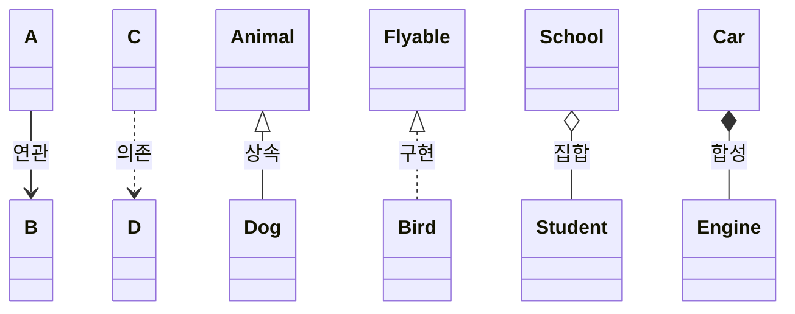

# [Day 15] LG CNS AM Inspire Camp 7기 TIL
작성일: 2026.11.16 (월) | 과목: AI 서비스 개발을 위한 백엔드

## 오늘 학습한 주제
- 개발 환경 세팅(MariaDB, JDK, STS, IntelliJ)과 GitHub 토큰, gh CLI 연동
- React vs Next.js 차이와 빌드 도구(Vite)가 필요한 이유, JDK/JRE/JVM과 Java의 플랫폼 독립성
- UML 클래스 다이어그램, 접근제한자, 캡슐화, 생성자 오버로딩과 기본 생성자 규칙

---

## 1. Front-end 복습: React vs Next.js와 빌드 도구

### 1-1. 빌드 도구(Vite)를 왜 쓸까?
프로젝트 만들 때 당연하게 Vite를 썼는데, 왜 필요한지는 생각해본 적이 없었다. 오늘 수업에서 크게 세 가지 이유로 정리해 주셨다.

트랜스파일
- 자바스크립트는 1995년에 나왔고, 비슷한 스크립트 언어가 너무 많아서 Ecma International이라는 단체가 표준을 만든 게 ECMAScript라고 한다.
- 2015년 ES6에서 arrow function, template literal, destructuring, import/export, class 같은 문법이 한꺼번에 추가됐다.
- 근데 이런 최신 문법은 오래된 브라우저에서는 해석이 안 된다. 그래서 개발은 최신 문법으로 하고, 배포할 때는 낮은 버전 JS로 바꿔줘야 한다.
- 이 변환을 해주는 게 트랜스파일러다. 대표적으로 Babel이 있고, Rust로 만든 SWC는 Babel보다 훨씬 빠르다고 한다.

번들링
- JS 파일을 여러 개 만들어도 배포할 때는 하나로 묶어서 내보낸다. 안 묶으면 HTML에 script 태그를 파일 개수만큼 다 적어야 한다.
- Webpack은 예전에 많이 썼는데 느려서 요즘은 잘 안 쓴다고 하셨다.
- Vite는 내부에서 Rollup을 썼고, 요즘은 더 빠른 Rolldown 쪽으로 가는 추세라고 한다.
- 번들러는 JS뿐 아니라 CSS도 하나로 묶어준다.

ESLint
- lint가 옷에 붙은 보푸라기라는 뜻인데, 코드에 있는 규칙 위반이나 문제를 미리 찾아서 알려주는 도구다. 빨간펜 선생님 같은 느낌이다.

이 세 가지를 내가 따로 설치하고 설정하지 않아도 Vite가 알아서 불러서 써주는 거라 편한 것이다.

### 1-2. Vite와 CRA
- CRA는 예전에 React 프로젝트 만들 때 쓰던 도구인데 지금은 deprecated라서 더 이상 업데이트를 안 한다. 안에서 Webpack, Babel, ESLint를 썼고 많이 느렸다고 한다.
- Vite는 Vue를 만든 에반 유가 만들었고, Vite라는 이름이 프랑스어로 빠르다는 뜻이다.
- 개발 서버 포트는 CRA가 3000번, Vite가 5173번이다.
- HMR이라는 기능 덕분에 코드를 수정하면 새로고침 없이 바로 화면에 반영된다.
- Vite는 React 전용이 아니라 순수 JS나 TypeScript 프로젝트도 만들 수 있다.
- React는 자체 빌드 도구가 없어서 Vite 같은 걸 따로 써야 하는데, Next.js는 Vercel이 빌드 도구를 처음부터 넣어놨다.

### 1-3. CSR, SSR, SSG
- CSR은 브라우저에서 화면을 그리는 방식이다. 처음에 JS를 전부 받아야 해서 초기 로딩은 느리지만 그 뒤로 페이지 이동은 빠르다. 대신 검색엔진 최적화(SEO)에는 약하다.
- SSR은 서버에서 HTML을 다 만들어서 내려주는 방식이다. PHP나 JSP가 대표적이다. SEO에는 유리하지만 화면을 바꿀 때마다 서버에 다녀와야 한다.
- SSG는 내용이 거의 안 바뀌는 페이지를 미리 HTML로 만들어두는 방식이다.
- React는 CSR 중심이라 쇼핑몰을 React로만 만들면 검색 상위에 노출되기 불리하다. 그래서 Vercel이 SSR, SSG, CSR을 다 지원하는 Next.js를 만들었다고 한다.

### 1-4. React와 Next.js 비교
| 항목 | React | Next.js |
|---|---|---|
| 성격 | UI 라이브러리 | 풀스택 프레임워크 |
| 렌더링 | CSR 중심 | SSR, SSG, CSR 모두 |
| SEO | 불리 | 유리 |
| 라우팅 | React Router를 따로 설치하고 경로와 컴포넌트를 직접 연결 | 폴더 구조가 곧 경로 (`app/about/page.tsx` → `/about`) |
| 초기 로딩 | 느릴 수 있음 | 상대적으로 빠름 |
| 잘 맞는 곳 | 관리자 페이지, 대시보드 같은 SPA | 쇼핑몰, 블로그, 뉴스처럼 검색 노출이 중요한 사이트 |

- SPA는 index.html 하나만 두고 나머지는 전부 JS로 그리는 앱을 말한다.
- LG 계열사는 React 기반이 많고 카카오는 Next.js를 많이 쓴다고 한다.

### 1-5. 상태 관리
- 여러 컴포넌트나 페이지에서 같은 상태를 공유해야 할 때 쓴다. 예를 들면 페이지를 이동해도 로그인 정보가 유지되어야 하는 경우다.
- Redux가 원조인데 너무 복잡해서, 이번에는 훨씬 간단한 Zustand로 store를 만들어서 할 예정이라고 하셨다.

---

## 2. JDK, JRE, JVM

### 2-1. JDK와 JRE의 차이
- JDK는 개발자용이다. 컴파일러(`javac`) 같은 개발 도구가 들어 있고 JRE도 같이 포함되어 있다.
- JRE는 자바 프로그램을 실행하기 위한 환경이다. 그래서 내가 만든 프로그램을 다른 사람이 실행하려면 그 사람 컴퓨터에도 최소한 JRE는 있어야 한다.
- 우리가 지금 쓰는 건 Java SE라서 서버 없이 내 컴퓨터에서 단독으로 실행하는 프로그램을 만든다. Spring에서 쓰는 Java EE는 지금은 Jakarta EE로 이름이 바뀌었다고 한다.

### 2-2. C언어와 Java의 차이
- C언어는 컴파일하면 그 운영체제에 맞는 기계어가 나와서, Windows에서 컴파일한 걸 Linux에서 돌리려면 다시 컴파일해야 한다.
- Java는 컴파일하면 운영체제와 상관없는 바이트코드(`.class`)가 나온다. 그래서 Windows에서 만든 `.class`를 Linux나 Mac에서도 그대로 실행할 수 있고, 이걸 플랫폼 독립적이라고 한다.
- 대신 각 운영체제마다 JVM이 설치되어 있어야 한다. JVM은 JRE 안에 들어 있다.

### 2-3. 실행 과정과 성능
```
.java → (javac) → .class(바이트코드) → JVM이 로딩, 검증, 해석해서 실행
```
- Java는 컴파일과 인터프리터 방식을 같이 쓰는 하이브리드 방식이다.
- 실행하는 시점에 바이트코드를 그 운영체제에 맞는 기계어로 바꾸기 때문에 C보다는 조금 느릴 수 있다. 그래서 아주 정밀해야 하는 시스템에는 잘 안 쓰고, 은행도 코어 시스템은 C나 COBOL을 쓰는 곳이 많다고 하셨다.
- 이걸 보완하려고 JIT 컴파일러가 실행 중에 자주 쓰는 코드를 기계어로 바꿔서 저장해둔다.
- GraalVM이라는 것도 있는데, AOT 컴파일러로 컴파일할 때 바로 네이티브 이미지를 만들어서 더 빠르다고 한다. 이번 과정에서는 안 쓰고 OpenJDK를 쓴다.

---

## 3. UML 클래스 다이어그램

클래스 다이어그램 읽는 법을 배웠다.

### 3-1. 기본 구조
박스가 세 칸으로 나뉘어 있다.
- 맨 위: 클래스 이름
- 가운데: 속성(멤버 변수)
- 맨 아래: 메서드(행위)

인터페이스나 추상 클래스는 이름을 이탤릭체로 쓰거나 `«interface»`를 위에 적는다.

### 3-2. 클래스 사이의 관계
| 관계 | 선 모양 | 의미 |
|---|---|---|
| 연관 | 실선 + 화살표 | A가 B를 멤버 변수로 가지고 있음 |
| 의존 | 점선 + 화살표 | A가 B를 메서드 안이나 파라미터로 잠깐 사용함 |
| 상속 | 실선 + 속이 빈 삼각형 | `extends` |
| 구현 | 점선 + 속이 빈 삼각형 | `implements` |
| 집합 | 빈 마름모 | 전체와 부분인데 생명주기는 다름 (학교와 학생) |
| 합성 | 채운 마름모 | 전체와 부분이고 생명주기도 같음 (자동차와 엔진) |

위 표를 그림으로 그려보면 이렇게 된다.



### 3-3. 연관과 의존 헷갈린 부분
수업 중에 `AccountTest`와 `Account`의 관계가 뭐냐는 질문이 나왔는데 정답은 의존이었다. `main()` 메서드 안에서 객체를 만들어서 쓰고, 메서드가 끝나면 참조도 끝나기 때문이다.

판단 기준은 어디서 참조하느냐이다.
- 멤버 변수로 계속 가지고 있으면 연관이다. A가 살아 있는 동안 B도 계속 참조되니까 GC 대상이 안 된다.
- 메서드 안에서 잠깐 쓰고 끝나면 의존이다.
- 서로가 서로를 참조하는 양방향은 무한 루프에 빠질 수 있어서 잘 안 쓴다고 한다.

### 3-4. 집합과 합성
- 집합은 학교와 학생처럼, 학교가 없어져도 학생은 다른 학교에 다닐 수 있는 관계다.
- 합성은 자동차와 엔진처럼, 차가 없어지면 엔진도 같이 없어지는 관계다. 코드에서는 `Car` 안에서 `new Engine()`으로 직접 만드는 경우가 해당된다.
- 합성은 잘 안 쓰고 집합 정도만 알면 된다고 하셨다.

---

## 4. 접근제한자

범위가 넓은 순서는 `public` > `protected` > `default` > `private`이다.

| 기호 | 접근제한자 | 같은 클래스 | 같은 패키지 | 다른 패키지 자식 | 그 외 |
|:---:|---|:---:|:---:|:---:|:---:|
| `+` | public | O | O | O | O |
| `#` | protected | O | O | O | X |
| `~` | default | O | O | X | X |
| `-` | private | O | X | X | X |

- default는 접근제한자를 아예 안 쓴 경우를 말한다.
- `private`은 메서드와 변수에만 붙일 수 있고 클래스에는 못 붙인다.
- 패키지는 비슷한 클래스끼리 묶어놓은 폴더 같은 것이고, 다른 패키지에 있는 클래스를 쓰려면 import를 해야 한다.

수업 중 퀴즈로, 부모 `Shape`와 자식 `Circle`이 서로 다른 패키지일 때 `protected` 변수에 접근할 수 있냐는 문제가 나왔다. 답은 접근 가능이다. 패키지가 달라도 상속 관계면 쓸 수 있어서 default보다 범위가 조금 더 넓다.

---

## 5. 추상 메서드와 인터페이스

- 바디(중괄호 안의 구현)가 있는 메서드는 구체 메서드이고, 선언만 있고 구현이 없는 메서드는 추상 메서드다.
- 추상 클래스에서는 선언만 하는 메서드에 `abstract`를 꼭 붙여야 한다.
- 인터페이스는 `abstract`를 안 붙여도 자동으로 추상 메서드가 된다.

```java
abstract class Calc {
    public abstract int add(int a, int b);
}

interface Calculable {
    int add(int a, int b);
    int multiply(int a, int b);
}
```

- Java는 다중 상속이 안 되는데, 인터페이스는 여러 개를 `implements`할 수 있어서 이 한계를 보완해 준다.

---

## 6. 캡슐화

### 6-1. 왜 필요한가
변수를 `public`으로 열어두면 외부에서 `date.day = 32;`처럼 말이 안 되는 값을 넣을 수 있다. 컴파일 에러는 안 나는데 실제로는 32일이라는 날짜가 없으니까 나중에 계산할 때 결과가 이상해질 수 있다.

### 6-2. 해결 방법
- 변수는 `private`으로 막는다.
- 대신 값을 읽는 getter와 값을 바꾸는 setter를 `public`으로 만든다.
- setter 안에서 값이 올바른지 검사한다.

```java
private int month;

public int getMonth() { return month; }

public void setMonth(int month) {
    if (month >= 1 && month <= 12) {
        this.month = month;
    } else {
        System.out.println("Month는 1~12 사이의 값만 가능합니다.");
    }
}
```

이렇게 하면 데이터를 보호할 수 있고, 외부에서는 내부 구현을 몰라도 메서드 이름만 보고 쓰면 된다. 이게 캡슐화다.

### 6-3. 자바빈과 VO
`private` 필드, 기본 생성자, getter/setter로 이루어진 클래스를 자바빈 또는 VO라고 부른다.

### 6-4. 네이밍 규칙
- getter와 setter는 `get`, `set` 뒤에 변수명 첫 글자를 대문자로 바꿔서 붙인다. `year`면 `getYear()`, `myYear`면 `getMyYear()`다.
- 변수명은 반드시 소문자로 시작한다.
- 변수명을 전부 대문자로 쓰면 이 규칙이 안 맞아서 MyBatis 같은 프레임워크가 값을 못 읽는다. 앞으로 Spring이나 JPA도 이 규칙을 기반으로 동작한다.

---

## 7. 생성자

### 7-1. 기본 규칙
- 이름이 클래스 이름과 똑같아야 한다.
- 리턴 타입이 없다. `void`도 안 쓴다.
- 부모에서 자식으로 상속되지 않는다.
- `new`로 객체를 만들 때 호출되고, 보통 멤버 변수 초기화에 쓴다.

### 7-2. 기본 생성자와 오버로딩
- 파라미터가 없는 생성자가 기본 생성자다. 생성자를 하나도 안 만들면 컴파일러가 자동으로 넣어준다.
- 파라미터가 다른 생성자를 여러 개 만드는 걸 오버로딩이라고 한다. 값을 한 번에 초기화할 수 있어서 편하다.

### 7-3. 오늘 제일 중요했던 부분
생성자를 하나라도 직접 만들면 컴파일러가 기본 생성자를 자동으로 안 만들어 준다.

```java
public class MyDate {
    // 인자 있는 생성자만 있고 기본 생성자는 없음
    public MyDate(int year, int month, int day) { ... }
}

MyDate d = new MyDate();   // 컴파일 에러
```

실습에서 직접 확인했다.
1. 생성자를 전부 주석 처리하면 `new MyDate()`가 잘 된다. 컴파일러가 기본 생성자를 넣어줬기 때문이다.
2. 기본 생성자에 출력문을 넣고 실행하면 호출되는 게 보인다.
3. 인자 있는 생성자만 남기면 `new MyDate()`에서 에러가 난다.

그래서 인자 있는 생성자를 만들 때는 기본 생성자도 같이 직접 만들어 두는 게 좋다.

### 7-4. this
`this.year = year;`에서 `this.year`는 멤버 변수이고 `year`는 파라미터다. 이름이 같을 때 구분하려고 `this`를 쓴다. `this`를 빼고 `year = year;`라고 쓰면 자기 자신에게 대입하는 거라 값이 안 들어가고 경고가 뜬다.

### 7-5. 생성자에서도 검증을 거치게 하기
```java
public MyDate(int year, int month, int day) {
    this.year = year;
    // this.month = month;   // 이렇게 하면 setter 검증을 건너뜀
    setMonth(month);         // setter를 호출해서 검증을 거침
    this.day = day;
}
```
`new MyDate(2026, 13, 16)`을 했을 때 `this.month = month;`로 직접 넣으면 13이 그대로 들어갔다. `setMonth(month)`로 바꾸니까 경고 메시지가 나오고 값이 들어가지 않았다. setter에 검증이 있으면 생성자에서도 setter를 써야 한다는 걸 알게 됐다.

기본 생성자와 setter를 쓰면 값마다 setter를 따로 호출해야 하는데, 인자 있는 생성자는 객체를 만들면서 한 번에 초기화할 수 있다는 차이도 있다.

---

## 8. 실습 코드: MyDate, MyDateTest

### 8-1. MyDate.java
```java
package chapter3.oop;

//자바빈즈(Java Beans), VO(Value Object)
public class MyDate {
    private int year;
    private int month;
    private int day;

//  //default constructor
    public MyDate() {
        System.out.println("Default Constructor가 호출됨!!");
    }

    //constructor overloading (생성자 중복정의)
    public MyDate(int year, int month, int day) {
        this.year = year;
        // this.month = month;
        setMonth(month);
        this.day = day;
    }

    //setter method
    public void setYear(int year) {
        this.year = year;
    }
    //getter
    public int getYear() {
        return year;
    }
    public int getMonth() {
        return month;
    }
    public void setMonth(int month) {
        if(month >= 1 && month <= 12 ){
            this.month = month;
        }else {
            System.out.println("Month는 1~12 사이의 값만 가능합니다.");
        }
    }
    public int getDay() {
        return day;
    }
    public void setDay(int day) {
        this.day = day;
    }

//  @Override
//  public String toString() {
//      return year + "-" + month + "-" + day;
//  }
    @Override
    public String toString() {
        return "MyDate [year=" + year + ", month=" + month + ", day=" + day
                + "]";
    }
}
```

- 필드는 전부 `private`이다.
- 검증은 `setMonth()`에만 있고 `setDay()`에는 아직 없다. 나중에 1~31 체크를 추가해 봐야겠다.
- `toString()`은 아래쪽 버전(`MyDate [year=..., ...]` 형식)을 쓰고 위쪽은 주석 처리했다.

### 8-2. MyDateTest.java
```java
package chapter3.oop;

// Run 실행단축키: ctrl+f11

public class MyDateTest {
    public static void main(String[] args) {
        MyDate date = new MyDate();
        // date.day = 32;           // private 이라 컴파일 에러 (public 일 땐 가능했음)
        date.setMonth(13);
        System.out.println(date.getMonth());
        date.setDay(31);
        System.out.println(date.getDay());


        MyDate date2 = new MyDate(2026, 13, 16);
        System.out.println(date2.getMonth());
        System.out.println(date2.getDay());
    }
}
```

### 8-3. 실행 결과
```text
Default Constructor가 호출됨!!
Month는 1~12 사이의 값만 가능합니다.
0
31
Month는 1~12 사이의 값만 가능합니다.
0
16
```
`setMonth(13)`이 막혀서 month는 초기값인 0으로 남는다.

---

## 9. 트러블슈팅

- 설치하고 나서 `mysql`, `gh`, `git` 명령어를 인식하지 못했다. 설치하기 전에 열어둔 터미널은 PATH가 갱신이 안 돼서 그런 거였고, 새 터미널을 열면 해결됐다.
- MySQL이 이미 3306 포트를 쓰고 있으면 MariaDB 설치할 때 포트를 3307로 바꿔야 한다. 이 경우 나중에 앱에서 DB에 접속할 때도 3307로 설정해야 한다.
- `gh auth login`을 했더니 `missing required scope 'read:org'` 에러가 났다. 토큰 만들 때 `read:org` 권한을 체크 안 해서였고, 토큰 설정에서 권한을 추가하고 Update token을 누른 뒤 다시 로그인하니까 됐다.
- STS에서 Git Bash가 안 보였다. Preferences에서 경로를 Add하고 Apply하니까 보였다.

---

#LGCNS #LGCNS7기 #LGCNS7기TIL #내일배움카드 #K-DT
